# Project Omega

### Machine Learning Design Functions for R/C Sections
#### based on Eurocode 2 (EN 1992-1-1:2004) provisions

[](LICENSE)
[](https://doi.org/10.1016/j.engstruct.2020.111412)
[](https://doi.org/10.12989/sem.2024.92.4.341)


Closed-form functions that return the **required longitudinal reinforcement** of reinforced concrete sections under axial load and uniaxial or biaxial bending, **directly and without iterations**. Each function is the forward feed of an Artificial Neural Network (ANN), trained on tens of millions of exact section analyses according to Eurocode 2 and tested on hundreds of millions more. The functions are available as plain source code in **nine languages** (C#, C++, Delphi, Fortran, Java, Matlab, Python, VB.NET, VBA) and as a ready-to-use **Excel workbook**.

<p align="center">
  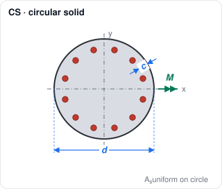
  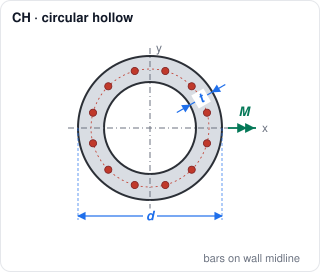
  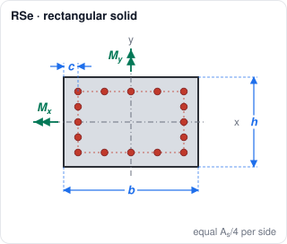
  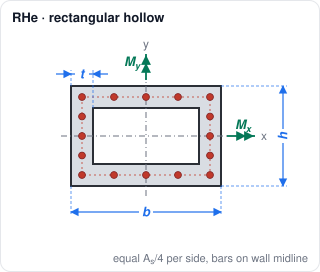
  <br>
  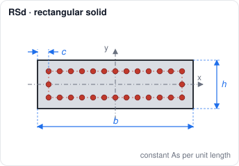
  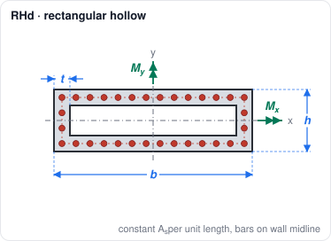
  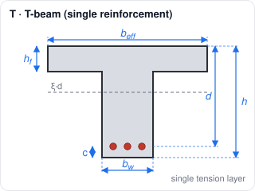
  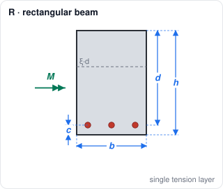
</p>

---

## Contents

- [Why Project Omega](#why-project-omega)
- [Sections and functions at a glance](#sections-and-functions-at-a-glance)
- [Conventions and units](#conventions-and-units)
- [Function reference](#function-reference)
- [Invalid input and return values](#invalid-input-and-return-values)
- [Quick start in each language](#quick-start-in-each-language)
- [Excel workbook](#excel-workbook)
- [Worked example](#worked-example)
- [How the functions were derived](#how-the-functions-were-derived)
- [Accuracy](#accuracy)
- [Versions](#versions)
- [Repository structure](#repository-structure)
- [How to cite](#how-to-cite)
- [Authors](#authors)
- [License and disclaimer](#license-and-disclaimer)

---

## Why Project Omega

Checking the capacity of a given R/C section is a straightforward task. The **inverse problem**, finding how much reinforcement a section needs for a given set of actions, is much harder: it requires either repeated section analyses with trial reinforcement, or derivative-based iterative schemes that can be slow and may fail to converge. In the past, engineers used design charts and interpolated by hand. Today the same problem is solved by iterative algorithms inside design software, many thousands of times for a single structure.

Project Omega follows the machine learning paradigm instead of the algorithmic one:

| | Traditional approach | Project Omega |
|---|---|---|
| Input | data + rules (constitutive laws, stress integration, equilibrium) | data + answers (millions of exact designs) |
| Output | answers, after iterations | the **rules**, as a closed-form function |
| Cost per design | many section analyses | a few hundred multiplications and `exp` calls |
| Numerical stability | convergence issues possible | unconditionally stable |

The result is a set of design functions that are:

- **Direct**: one call, one answer. No iterations, no convergence tolerance, no failure modes.
- **Fast**: about **120 times faster** than a fast biaxial design algorithm based on stress integration and a derivative-based iterative scheme (one million rectangular sections in 5 s versus 600 s, boundary checks included). It is practical to design for every load combination instead of an envelope, or to run metaheuristic optimization of R/C sections, even inside a spreadsheet.
- **Accurate**: the maximum absolute error in the mechanical reinforcement ratio ω is **below 0.008** over all test sets, and the mean absolute error is about 0.0002. This is smaller than the unavoidable rounding up when actual bar diameters are chosen.
- **Safe against invalid input**: input outside the training ranges, or bending moments that the section cannot carry within the reinforcement limits, return `NaN` instead of a misleading number.
- **Portable**: plain source code without any machine learning library, in nine languages.

The name comes from **ω**, the mechanical reinforcement ratio. In every section the `w_*` functions return ω and the `As_*` functions return the reinforcement area A<sub>s</sub>.

---

## Sections and functions at a glance

| Section | Reinforcement layout | ω function | A<sub>s</sub> function | Valid ranges | Network |
|---|---|---|---|---|---|
| **CS** circular solid | uniform on a circle at cover c | `w_CS(cd, n, m)` | `As_CS(d, c, fcd, N, M)` | c/d 0.01 to 0.15 | 3-15-15-1 |
| **CH** circular hollow | uniform on the wall midline | `w_CH(td, n, m)` | `As_CH(d, t, fcd, N, M)` | t/d 0.05 to 0.20 | 3-15-15-1 |
| **RSe** rectangular solid | equal, A<sub>s</sub>/4 per side | `w_RSe(bh, cb, n, mx, my)` | `As_RSe(b, h, c, fcd, N, Mx, My)` | b/h 1.0 to 2.0, c/b 0.01 to 0.15 | 9-35-35-1 |
| **RHe** rectangular hollow | equal, A<sub>s</sub>/4 per side, on the wall midline | `w_RHe(bh, tb, n, mx, my)` | `As_RHe(b, h, t, fcd, N, Mx, My)` | b/h 1.0 to 2.0, t/b 0.05 to 0.20 | 9-35-35-1 |
| **RSd** rectangular solid | distributed, constant A<sub>s</sub> per unit length | `w_RSd(bh, ch, n, mx, my)` | `As_RSd(b, h, c, fcd, N, Mx, My)` | b/h 1.0 to 6.0, c/h 0.01 to 0.15 | 3 × 9-35-35-1 |
| **RHd** rectangular hollow | distributed, constant A<sub>s</sub> per unit length, on the wall midline | `w_RHd(bh, th, n, mx, my)` | `As_RHd(b, h, t, fcd, N, Mx, My)` | b/h 1.0 to 6.0, t/h 0.05 to 0.20 | 3 × 9-35-35-1 |
| **T** T-beam | single tension layer | `w_T(beffbw, hfd, m)`, `x_T(beffbw, hfd, m)` | `As_T(beff, bw, h, hf, c, fcd, M, N)` | b<sub>eff</sub>/b<sub>w</sub> 1.0 to 10.0, h<sub>f</sub>/d 0.05 to 0.25 | 3-35-35-1 (ω and ξ) |
| **R** rectangular beam | single tension layer | `w_R(m)`, `x_R(m)` | `As_R(b, h, c, fcd, M, N)` | as T with b<sub>eff</sub> = b<sub>w</sub> | T network |

For all columns: ν from −0.6 to +0.1. The moment range is not given explicitly; it is checked by a boundary network (see [Invalid input](#invalid-input-and-return-values)).

The `w_*` functions take **normalized** quantities and return the **mechanical reinforcement ratio ω**; the `x_*` functions (T, R) return the neutral axis depth ratio ξ. The `As_*` functions take **dimensions, concrete strength and actions** and return the **reinforcement area A<sub>s</sub>**. Every `As_*` function normalizes its input, calls the corresponding `w_*` function and converts ω back to an area.

**Which rectangular layout?** RSe/RHe (equal A<sub>s</sub>/4 per side) and RSd/RHd (constant A<sub>s</sub> per unit length) give the same result for square sections. For b/h > 1, uniformly distributed reinforcement is more economical when bending is mainly about the x axis (M<sub>x</sub>, reinforcement needed along the long sides), while equal reinforcement per side is more economical when bending is mainly about the y axis (M<sub>y</sub>, reinforcement needed along the short sides). Both can be evaluated and the smaller one chosen. For elongated sections (b/h > 2, typical of bridge piers) only RSd/RHd apply.

---

## Conventions and units

### Units of the `As_*` functions

All arguments are in **m, kN and kPa** (kN/m²). The result is in **m²**.

| Quantity | Unit | Example |
|---|---|---|
| dimensions b, h, d, c, t, b<sub>eff</sub>, b<sub>w</sub>, h<sub>f</sub> | m | 0.60 |
| concrete design strength f<sub>cd</sub> | kPa | C30/37 with α<sub>cc</sub> = 1.0: f<sub>cd</sub> = 30 / 1.5 = 20 MPa → `20000` |
| axial force N | kN, **compression negative** | `-1500` |
| bending moments M, M<sub>x</sub>, M<sub>y</sub> | kNm, **always positive**: absolute values for columns, sagging for beams | `400` |
| result A<sub>s</sub> | m² | `0.004291` m² = 42.91 cm² |

The steel design strength is built into the `As_*` functions: **f<sub>yd</sub> = 500 / 1.15 MPa** (B500, γ<sub>s</sub> = 1.15). The networks were trained for this steel, so the functions are valid only for B500 reinforcement. Any concrete class from C12/15 to C50/60 can be used, since f<sub>cd</sub> enters only through the normalization; choose α<sub>cc</sub> according to your National Annex (see below for EN 1992-1-1:2023).

### Normalized quantities of the `w_*` functions

| Symbol | Argument | Definition |
|---|---|---|
| ν | `n` | N / (A<sub>c</sub> · f<sub>cd</sub>), compression negative |
| μ | `m` | M / (A<sub>c</sub> · d · f<sub>cd</sub>), circular sections |
| μ<sub>x</sub> | `mx` | M<sub>x</sub> / (A<sub>c</sub> · h · f<sub>cd</sub>), rectangular sections (= M<sub>x</sub> / (b · h² · f<sub>cd</sub>) for solid ones) |
| μ<sub>y</sub> | `my` | M<sub>y</sub> / (A<sub>c</sub> · b · f<sub>cd</sub>), rectangular sections (= M<sub>y</sub> / (b² · h · f<sub>cd</sub>) for solid ones) |
| μ | `m` | M / (b<sub>eff</sub> · d² · f<sub>cd</sub>) for the T-beam, M / (b · d² · f<sub>cd</sub>) for the rectangular beam |
| ω | result | A<sub>s</sub> · f<sub>yd</sub> / (A<sub>c</sub> · f<sub>cd</sub>) for columns, A<sub>s</sub> · f<sub>yd</sub> / (b<sub>eff</sub> · d · f<sub>cd</sub>) for the T-beam, A<sub>s</sub> · f<sub>yd</sub> / (b · d · f<sub>cd</sub>) for the rectangular beam |
| ξ | result of `x_*` | x / d, depth of the neutral axis over the effective depth |

A<sub>c</sub> is the gross concrete area: π·d²/4 (CS), π·(d² − (d − 2t)²)/4 (CH), b·h (RSe, RSd), b·h − (b − 2t)·(h − 2t) (RHe, RHd).

### Geometry

- **Rectangular columns: b ≥ h** (b/h ≥ 1). The x axis runs along b and the y axis along h, as in the sketches, where the moments are drawn as double-arrow vectors on the axes. **M<sub>x</sub>** bends the section about the x axis (needs reinforcement along the long sides b), **M<sub>y</sub>** about the y axis (along the short sides h).
- **Cover c** is measured from the outer face to the **centerline of the bars** and is constant around the whole perimeter, as in actual practice. Classic design charts use different ratios b<sub>1</sub>/b and h<sub>1</sub>/h instead.
- In **hollow sections** the reinforcement lies on the **midline of the wall thickness t**, representing two equal layers placed symmetrically near the outer and inner faces.
- **T-beams and rectangular beams** are singly reinforced, with one tension layer at cover c from the bottom face and effective depth d = h − c. The optional axial force N acts at the centroid of the gross section and is transferred to the tension steel level internally.

### Use with the second generation EN 1992-1-1:2023

The networks were trained with EN 1992-1-1:2004, but the functions can also be used with EN 1992-1-1:2023:

- The concrete law is the same parabola-rectangle with ε<sub>c2</sub> = 2 ‰ and ε<sub>cu</sub> = 3.5 ‰ (§8.1.2), now for **all strength classes** up to f<sub>ck</sub> = 100 MPa. The steel law with a horizontal branch without strain limit (§5.2.4(2)b) and γ<sub>s</sub> = 1.15 are unchanged.
- Compute the design strength as f<sub>cd</sub> = η<sub>cc</sub> · k<sub>tc</sub> · f<sub>ck</sub> / γ<sub>C</sub>, with η<sub>cc</sub> = (f<sub>ck,ref</sub> / f<sub>ck</sub>)<sup>1/3</sup> ≤ 1 (Formulas 5.3 and 5.4), and pass it as `fcd`. Since f<sub>cd</sub> enters only through the normalization, nothing else changes.
- EN 1992-1-1:2023 (Figure 8.1) no longer limits fully compressed sections with the pivot ε<sub>c2</sub> at 3h/7; the extreme fibre always reaches ε<sub>cu</sub>, and under pure compression the steel develops f<sub>yd</sub> (Formula 8.3). For sections under high compression and small moments the 2023 capacity is therefore slightly higher, and the functions return **slightly more reinforcement than needed, on the safe side**. Where the neutral axis lies within the section, both editions give the same result.

### Moment sign convention

**All functions take positive moments.** The code enforces this: the column functions use the absolute values of the moments, and the beam functions return `NaN` for a negative moment.

The double arrows in the sketches are the **positive moment vectors** (right-hand rule): M<sub>x</sub> points along −x and M<sub>y</sub> along +y, so positive M<sub>x</sub> and M<sub>y</sub> both compress the upper right quadrant of the section.

- **Columns (RSe, RSd, RHe, RHd, CS, CH):** the sections are doubly symmetric, so the sign of a moment does not change the required reinforcement. The training data cover moment vector angles from 0° to 90° only, so the functions take the absolute values of M<sub>x</sub>, M<sub>y</sub> and M internally, and any combination of signs gives the same result.
- **Beams (T, R):** a positive M causes **tension at the bottom fibre** (sagging), where the single reinforcement layer lies, and compression in the flange. A negative M returns `NaN`. `NaN` is also returned when a large axial tension makes the moment about the steel M − N·y<sub>s1</sub> negative, since the section then needs reinforcement at both faces. For a hogging moment the flange of a T-beam is in tension, so use `As_R` with b = b<sub>w</sub> and the reinforcement at the top.

---

## Function reference

Each section below shows the sketch, the syntax and the arguments.

### Circular solid section (CS)


```
w_CS(cd, n, m)
As_CS(d, c, fcd, N, M)
```

| Argument | Meaning |
|---|---|
| `cd` | c/d, cover over diameter (0.01 to 0.15) |
| `n` | ν, normalized axial (−0.6 to +0.1) |
| `m` | μ, normalized moment |
| `d`, `c` | diameter, cover |
| `fcd`, `N`, `M` | concrete strength, axial, moment |

### Circular hollow section (CH)


```
w_CH(td, n, m)
As_CH(d, t, fcd, N, M)
```

| Argument | Meaning |
|---|---|
| `td` | t/d, wall thickness over diameter (0.05 to 0.20) |
| `n` | ν, normalized axial (−0.6 to +0.1) |
| `m` | μ, normalized moment |
| `d`, `t` | outer diameter, wall thickness |
| `fcd`, `N`, `M` | concrete strength, axial, moment |

### Rectangular solid section, equal reinforcement per side (RSe)


```
w_RSe(bh, cb, n, mx, my)
As_RSe(b, h, c, fcd, N, Mx, My)
```

| Argument | Meaning |
|---|---|
| `bh` | b/h, width over height (1.0 to 2.0) |
| `cb` | c/b, cover over width (0.01 to 0.15) |
| `n` | ν, normalized axial (−0.6 to +0.1) |
| `mx`, `my` | μ<sub>x</sub>, μ<sub>y</sub>, normalized moments |
| `b`, `h`, `c` | width, height, cover |
| `fcd`, `N`, `Mx`, `My` | concrete strength, axial, moments |

### Rectangular hollow section, equal reinforcement per side (RHe)


```
w_RHe(bh, tb, n, mx, my)
As_RHe(b, h, t, fcd, N, Mx, My)
```

| Argument | Meaning |
|---|---|
| `bh` | b/h, width over height (1.0 to 2.0) |
| `tb` | t/b, wall thickness over width (0.05 to 0.20) |
| `n` | ν, normalized axial (−0.6 to +0.1) |
| `mx`, `my` | μ<sub>x</sub>, μ<sub>y</sub>, normalized moments |
| `b`, `h`, `t` | width, height, wall thickness |
| `fcd`, `N`, `Mx`, `My` | concrete strength, axial, moments |

### Rectangular solid section, distributed reinforcement (RSd)


```
w_RSd(bh, ch, n, mx, my)
As_RSd(b, h, c, fcd, N, Mx, My)
```

| Argument | Meaning |
|---|---|
| `bh` | b/h, width over height (1.0 to 6.0) |
| `ch` | c/h, cover over height (0.01 to 0.15) |
| `n` | ν, normalized axial (−0.6 to +0.1) |
| `mx`, `my` | μ<sub>x</sub>, μ<sub>y</sub>, normalized moments |
| `b`, `h`, `c` | width, height, cover |
| `fcd`, `N`, `Mx`, `My` | concrete strength, axial, moments |

Three separate networks cover b/h 1 to 2, 2 to 4 and 4 to 6; the function selects the right one.

### Rectangular hollow section, distributed reinforcement (RHd)


```
w_RHd(bh, th, n, mx, my)
As_RHd(b, h, t, fcd, N, Mx, My)
```

| Argument | Meaning |
|---|---|
| `bh` | b/h, width over height (1.0 to 6.0) |
| `th` | t/h, wall thickness over height (0.05 to 0.20) |
| `n` | ν, normalized axial (−0.6 to +0.1) |
| `mx`, `my` | μ<sub>x</sub>, μ<sub>y</sub>, normalized moments |
| `b`, `h`, `t` | width, height, wall thickness |
| `fcd`, `N`, `Mx`, `My` | concrete strength, axial, moments |

Three separate networks cover b/h 1 to 2, 2 to 4 and 4 to 6.

### T-beam, single reinforcement (T)


```
w_T(beffbw, hfd, m)
x_T(beffbw, hfd, m)
As_T(beff, bw, h, hf, c, fcd, M, N)   ' N optional, default 0
```

| Argument | Meaning |
|---|---|
| `beffbw` | b<sub>eff</sub>/b<sub>w</sub>, flange width over web width (1.0 to 10.0) |
| `hfd` | h<sub>f</sub>/d, flange thickness over effective depth (0.05 to 0.25) |
| `m` | μ = M / (b<sub>eff</sub> · d² · f<sub>cd</sub>) |
| `beff`, `bw`, `h`, `hf`, `c` | flange width, web width, height, flange thickness, cover |
| `fcd`, `M`, `N` | concrete strength, moment, optional axial |

`x_T` returns ξ = x/d, the depth of the neutral axis over the effective depth.

### Rectangular beam, single reinforcement (R)


```
w_R(m)
x_R(m)
As_R(b, h, c, fcd, M, N)   ' N optional, default 0
```

| Argument | Meaning |
|---|---|
| `m` | μ = M / (b · d² · f<sub>cd</sub>) |
| `b`, `h`, `c` | width, height, cover |
| `fcd`, `M`, `N` | concrete strength, moment, optional axial |

The rectangular beam is the T-beam with b<sub>eff</sub> = b<sub>w</sub>, so the h<sub>f</sub>/d value is irrelevant.

---

## Invalid input and return values

The networks must never be used outside the region where they were trained, because their extrapolation is unpredictable: a highly nonlinear function can return a plausible ω between 0 and 0.7 for a moment that the section cannot carry at all. Every function therefore checks its input in three steps:

1. **Parameter ranges.** Geometric ratios and ν outside the ranges in the tables return `NaN`.
2. **Moment boundary.** Small auxiliary networks (at most two hidden layers of 8 nodes) predict the maximum normalized moment the section can carry with ω = 0.75, for the given geometry, ν and moment direction. Larger moments return `NaN`.
3. **Reinforcement limit.** Results above ω = 0.70 for columns, or ω = 0.50 for beams, return `NaN`. Negative network outputs are set to 0 (no reinforcement needed).
4. **Moment sign.** Beams (T, R) return `NaN` for a negative moment. Columns accept any sign (see [Moment sign convention](#moment-sign-convention)).
5. **Neutral axis.** `x_T` and `x_R` return `NaN` whenever `w_T` or `w_R` does, so ξ is given only together with a valid ω.

Return values per language:

| Language | Invalid input returns |
|---|---|
| C#, C++, Delphi, Fortran, Java, Matlab, Python, VB.NET | `NaN` (test with `isnan`, `Double.IsNaN`, `math.isnan`, `ieee_is_nan`…) |
| VBA / Excel, v2.0 | `#N/A` |
| VBA / Excel, v1.0 | `-1` |

---

## Quick start in each language

All examples compute the [worked example](#worked-example) below: a 600 × 500 mm column, C20/25 (f<sub>cd</sub> = 20 / 1.5 MPa), cover 50 mm, N = −400 kN, M<sub>x</sub> = 100 kNm, M<sub>y</sub> = 480 kNm, with equal reinforcement per side. The answer is **A<sub>s</sub> = 0.004291 m² = 42.91 cm²**.

The source files are in `Functions v2.0/<language>/`. Copy the file into your project. Every example computes A<sub>s</sub> with `As_RSe` and the same section in normalized form with `w_RSe`, checks for invalid input and prints **42.91 cm²** and **ω = 0.4664**.

<details open>
<summary><b>Python</b> · <code>Python/MLDF.py</code></summary>

```python
import math
import MLDF

As = MLDF.As_RSe(0.60, 0.50, 0.05, 20000/1.5, -400, 100, 480)   # m²
w = MLDF.w_RSe(1.2, 0.05/0.6, -0.1, 0.05, 0.2)                  # ω
if math.isnan(As):
    print('invalid input')
else:
    print(f'{As*1e4:.2f} {w:.4f}')                              # 42.91 0.4664
```
</details>

<details>
<summary><b>C++</b> · <code>C++/MLDF.cpp</code></summary>

```cpp
#include "MLDF.cpp"                                                // plain static functions
#include <cstdio>

double As = As_RSe(0.60, 0.50, 0.05, 20000/1.5, -400, 100, 480);   // m²
double w = w_RSe(1.2, 0.05/0.6, -0.1, 0.05, 0.2);                  // ω
if (isnan(As))
    printf("invalid input\n");
else
    printf("%.2f %.4f\n", As*1e4, w);                              // 42.91 0.4664
```
</details>

<details>
<summary><b>C#</b> · <code>C#/MLDF.cs</code></summary>

```csharp
double As = MLDF.As_RSe(0.60, 0.50, 0.05, 20000/1.5, -400, 100, 480);   // m²
double w = MLDF.w_RSe(1.2, 0.05/0.6, -0.1, 0.05, 0.2);                  // ω
if (double.IsNaN(As))
    Console.WriteLine("invalid input");
else
    Console.WriteLine($"{As*1e4:F2} {w:F4}");                           // 42.91 0.4664
```
</details>

<details>
<summary><b>Java</b> · <code>Java/MLDF.java</code></summary>

```java
double As = MLDF.As_RSe(0.60, 0.50, 0.05, 20000/1.5, -400, 100, 480);   // m²
double w = MLDF.w_RSe(1.2, 0.05/0.6, -0.1, 0.05, 0.2);                  // ω
if (Double.isNaN(As))
    System.out.println("invalid input");
else
    System.out.printf("%.2f %.4f%n", As*1e4, w);                        // 42.91 0.4664
```
</details>

<details>
<summary><b>VB.NET</b> · <code>VB.NET/MLDF.vb</code></summary>

```vb
Dim As_ As Double = MLDF.As_RSe(0.6, 0.5, 0.05, 20000 / 1.5, -400, 100, 480)   ' m²
Dim w As Double = MLDF.w_RSe(1.2, 0.05 / 0.6, -0.1, 0.05, 0.2)                 ' ω
If Double.IsNaN(As_) Then
    Console.WriteLine("invalid input")
Else
    Console.WriteLine($"{As_ * 10000.0:F2} {w:F4}")                            ' 42.91 0.4664
End If
```

The module relies on the project-level import of `System`, which Visual Studio adds by default.
</details>

<details>
<summary><b>Fortran</b> · <code>Fortran/MLDF.f90</code></summary>

```fortran
use MLDF
real(kind=8) :: As, w
As = As_RSe(0.6d0, 0.5d0, 0.05d0, 20000d0/1.5d0, -400d0, 100d0, 480d0)   ! m²
w = w_RSe(1.2d0, 0.05d0/0.6d0, -0.1d0, 0.05d0, 0.2d0)                    ! ω
if (ieee_is_nan(As)) then
    print *, 'invalid input'
else
    print '(F6.2, F7.4)', As*1d4, w                                      ! 42.91 0.4664
end if
```

The lines of the module are long. With gfortran compile with `-ffree-line-length-none`. All arguments are `real(kind=8)`; `N` is optional in `As_T` and `As_R`.
</details>

<details>
<summary><b>Delphi / Free Pascal</b> · <code>Delphi/MLDF.pas</code></summary>

```pascal
uses Math, MLDF;
var As_, w: Double;
...
As_ := As_RSe(0.6, 0.5, 0.05, 20000/1.5, -400, 100, 480);   // m²
w := w_RSe(1.2, 0.05/0.6, -0.1, 0.05, 0.2);                 // ω
if IsNan(As_) then
    WriteLn('invalid input')
else
    WriteLn(As_*1e4:0:2, ' ', w:0:4);                       // 42.91 0.4664
```
</details>

<details>
<summary><b>Matlab / Octave</b> · <code>Matlab/MLDF.m</code></summary>

```matlab
As = MLDF.As_RSe(0.60, 0.50, 0.05, 20000/1.5, -400, 100, 480);   % m²
w = MLDF.w_RSe(1.2, 0.05/0.6, -0.1, 0.05, 0.2);                  % ω
if isnan(As)
    disp('invalid input')
else
    fprintf('%.2f %.4f\n', As*1e4, w)                            % 42.91 0.4664
end
```

`MLDF` is a class with static methods; keep `MLDF.m` on the path.
</details>

<details>
<summary><b>VBA / Excel</b> · <code>VBA (Excel)/MLDF.xlsm</code></summary>

```
=IFERROR(As_RSe(0.6, 0.5, 0.05, 20000/1.5, -400, 100, 480)*10000, "invalid input")    → 42.91
=IFERROR(w_RSe(1.2, 0.05/0.6, -0.1, 0.05, 0.2), "invalid input")                      → 0.4664
```

Invalid input returns `#N/A`, which `IFERROR` turns into the text. With a Greek or other regional setting that uses the decimal comma, write `0,6` and separate the arguments with `;`. See [Excel workbook](#excel-workbook).
</details>

---

## Excel workbook

`Functions v2.0/VBA (Excel)/MLDF.xlsm` contains all functions as worksheet functions (module `MLDF`) and an interactive sheet with one block per section: normalized input for the `w_*` functions and absolute input for the `As_*` functions. The input cells of the sheet use practical units (m, cm for covers and thicknesses, MPa, kN, kNm) and the result is shown in cm²; the formulas convert them to the m, kN, kPa units of the functions, for example:

```
=As_RSd(B51, B52, B53/100, B54*1000, B55, B56, B57)*10000
```

Notes:

- Enable macros when the workbook opens, otherwise the cells show `#NAME?`.
- The functions can be copied to any workbook: open the VBA editor (Alt+F11) and drag the `MLDF` module to the other workbook, or export and import `MLDF.bas`.
- In regional settings with a decimal comma (e.g. Greek, German, French), Excel separates the arguments with a semicolon: `=w_RSe(1,2; 0,0833; -0,1; 0,05; 0,2)`.
- Invalid input shows `#N/A` and propagates to the `As_*` cells.

---

## Worked example

The worked example of the 2024 paper, originally solved with a classic design chart for biaxial bending:

| | |
|---|---|
| Section | 600 × 500 mm (b = 0.60 m, h = 0.50 m) |
| Materials | C20/25 (f<sub>cd</sub> = 20 / 1.5 = 13.33 MPa), B500C |
| Cover | c = 50 mm |
| Actions | N = −400 kN, M<sub>x</sub> = 100 kNm, M<sub>y</sub> = 480 kNm |

Normalized input: b/h = 1.2, c/b = 0.0833, c/h = 0.10, ν = −400 / (0.30 · 13333) = −0.10, μ<sub>x</sub> = 100 / (0.60 · 0.50² · 13333) = 0.05, μ<sub>y</sub> = 480 / (0.60² · 0.50 · 13333) = 0.20.

| Method | ω | A<sub>s</sub> |
|---|---|---|
| Design chart (b<sub>1</sub>/b = h<sub>1</sub>/h, interpolated) | 0.485 | 44.6 cm² |
| `w_RSe` / `As_RSe`, equal A<sub>s</sub>/4 per side | 0.466 | **42.91 cm²** |
| `w_RSd` / `As_RSd`, constant A<sub>s</sub> per unit length | 0.477 | 43.92 cm² |

The small difference from the chart comes from the cover: the chart assumes the same cover **ratio** in both directions, while the functions use the same cover **width** around the perimeter, as built. Here bending about y dominates, so equal reinforcement per side is slightly more economical than distributed reinforcement.

---

## How the functions were derived

**1. Training data.** A validated algorithm for the analysis of arbitrary composite sections under biaxial bending and axial load was wrapped in a section generator. For every combination of geometry, ν, ω and moment direction it computed the ultimate normalized moments according to **Eurocode 2 (EN 1992-1-1:2004)**:

- concrete C12/15 to C50/60, parabola-rectangle law, ε<sub>c2</sub> = 2.0 ‰, ε<sub>cu2</sub> = 3.5 ‰
- steel B500C, bilinear law without hardening and without an ultimate strain limit, γ<sub>s</sub> = 1.15
- strain pivots and section equilibrium according to EN 1992-1-1:2004

Training inputs were evenly discretized; test inputs were random and about 2 to 11 times more numerous.

| Section | Training instances | Test instances | Ranges |
|---|---:|---:|---|
| CS | 88,394 | 987,367 | c/d 0.01 to 0.15, ν −0.6 to 0.1, ω 0 to 0.75 |
| CH | 176,823 | 987,384 | t/d 0.05 to 0.20, ν −0.6 to 0.1, ω 0 to 0.75 |
| RSd | 116,051,058 | 236,930,728 | b/h 1.0 to 6.1, c/h 0.01 to 0.15, ν −0.6 to 0.1, ω 0 to 0.75, θ 0° to 90° |
| RHd | 130,565,988 | 266,561,257 | b/h 1.0 to 6.1, t/h 0.05 to 0.21, ν −0.6 to 0.1, ω 0 to 0.75, θ 0° to 90° |
| T | 380,100 | 1,996,095 | b<sub>eff</sub>/b<sub>w</sub> up to 10, h<sub>f</sub>/d 0.05 to 0.25, ω 0 to 0.5 |
| RSe, RHe (v1.0) | about 37 and 42 million | about 75 and 84 million | b/h 1.0 to 2.0 |

**2. Networks.** Fully connected networks with two hidden layers of equal size and sigmoid activation were trained with TensorFlow / Keras. Small networks and tree-based learners (M5, M5Rules) could not capture the nonlinearity; the training sets are so large that overfitting is not an issue. The rectangular sections use **9 inputs**: the five design variables (b/h, c/h or t/h, ν, μ<sub>x</sub>, μ<sub>y</sub>) plus engineered features (μ = √(μx² + μy²), μx², μy², μ<sub>x</sub>·μ<sub>y</sub>). Circular sections use 3 inputs and 15 nodes per hidden layer; rectangular sections and T-beams use 35 nodes per hidden layer. For b/h up to 6, three networks cover the ranges 1 to 2, 2 to 4 and 4 to 6, so the larger range costs nothing in speed.

**3. Boundary networks.** Small auxiliary networks, trained for a fixed ω = 0.75, predict the largest admissible normalized moment for the given input and moment direction. They screen out moments outside the valid region, where the main networks would extrapolate (see [Invalid input](#invalid-input-and-return-values)).

**4. Code generation.** The forward feed of each trained network, inputs normalization included, was written out as plain code: only multiplications, additions and `exp`. The same code was translated to all nine languages with an in-house translator and checked with the same test harness in each language.

---

## Accuracy

Test results of the v2.0 networks on the random test sets (ω<sub>pred</sub> − ω, or ξ<sub>pred</sub> − ξ for the T-beam neutral axis):

| Network | Test instances | MAE | Max positive error | Max negative error | RMSE | R² |
|---|---:|---:|---:|---:|---:|---:|
| CS 3-15-15-1 | 987,367 | 0.000125 | 0.001090 | −0.001601 | 0.000163 | 1.000000 |
| CH 3-15-15-1 | 987,384 | 0.000117 | 0.000904 | −0.000837 | 0.000160 | 1.000000 |
| RSd b/h 1–2, 9-35-35-1 | 78,991,674 | 0.000168 | 0.005950 | −0.005560 | 0.000255 | 0.999999 |
| RSd b/h 2–4, 9-35-35-1 | 78,977,843 | 0.000281 | 0.004355 | −0.003734 | 0.000332 | 0.999999 |
| RSd b/h 4–6, 9-35-35-1 | 78,961,211 | 0.000225 | 0.007318 | −0.007882 | 0.000330 | 0.999999 |
| RHd b/h 1–2, 9-35-35-1 | 88,871,081 | 0.000214 | 0.003090 | −0.004785 | 0.000308 | 0.999999 |
| RHd b/h 2–4, 9-35-35-1 | 88,854,397 | 0.000167 | 0.006656 | −0.003695 | 0.000251 | 0.999999 |
| RHd b/h 4–6, 9-35-35-1 | 88,835,779 | 0.000231 | 0.007506 | −0.005543 | 0.000345 | 0.999999 |
| T, ω, 3-35-35-1 | 1,996,095 | 0.000212 | 0.006607 | −0.006229 | 0.000380 | 0.999997 |
| T, ξ, 3-35-35-1 | 1,996,095 | 0.000471 | 0.002531 | −0.001270 | 0.000525 | 1.000000 |

For the legacy RSe and RHe networks (v1.0) the maximum error is below 0.0065 and the MAE about 0.0002 (Charalampakis and Papanikolaou 2021).

<details>
<summary><b>Error plots of each network</b></summary>

Each plot shows the error against ω for every test instance (bottom left), the mean and the extreme errors per ω interval (top left) and the histogram of the errors (right).

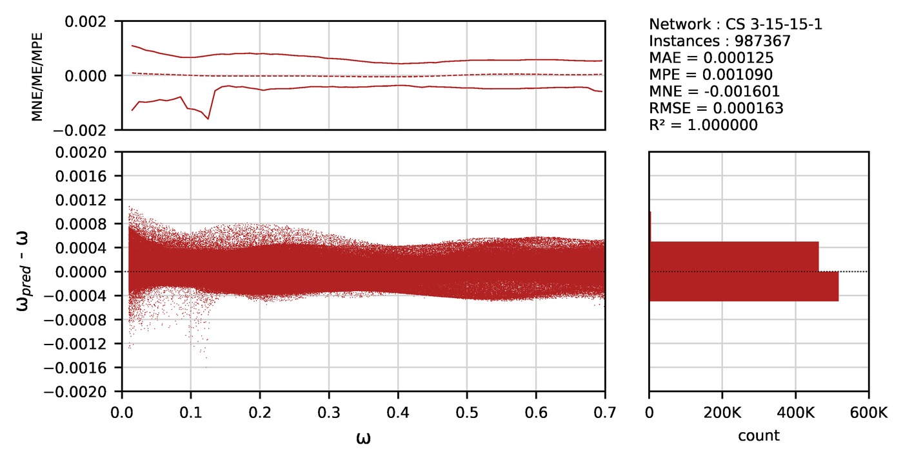 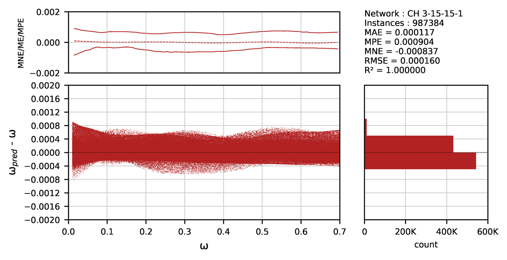
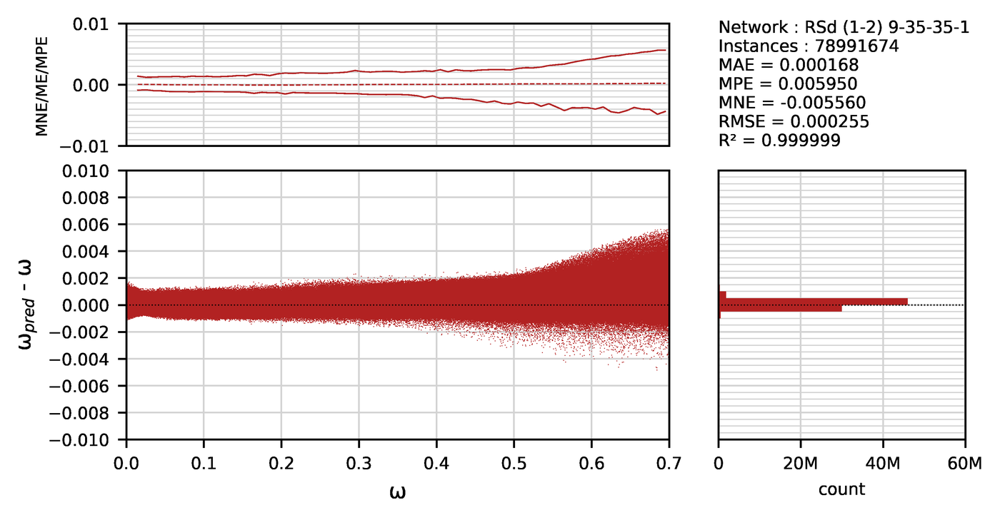 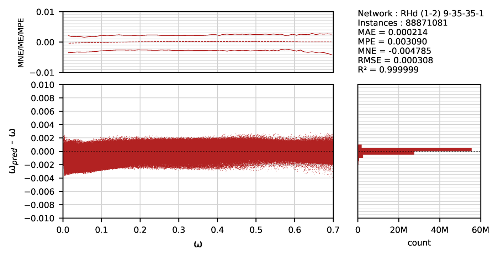
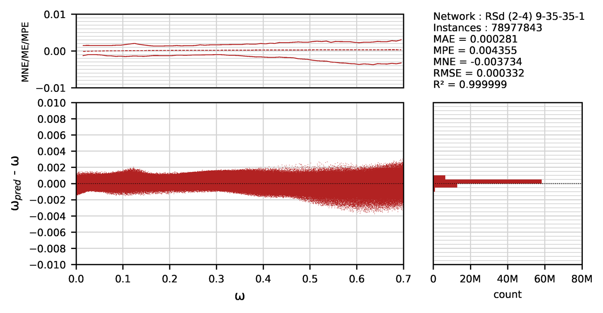 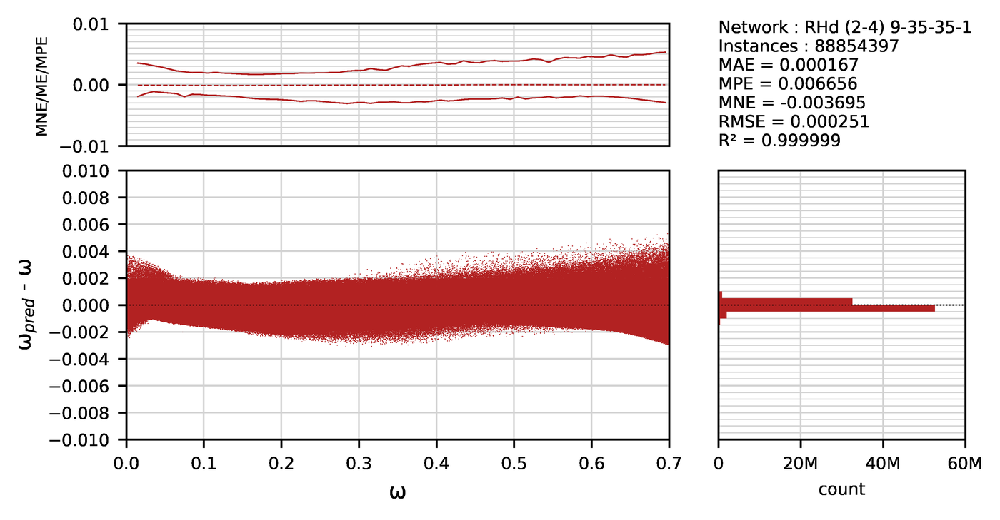
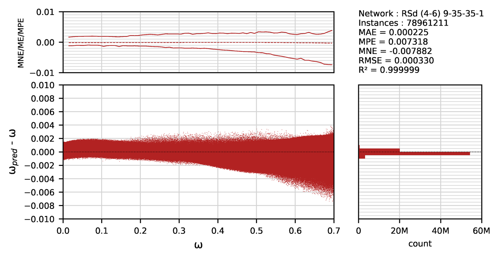 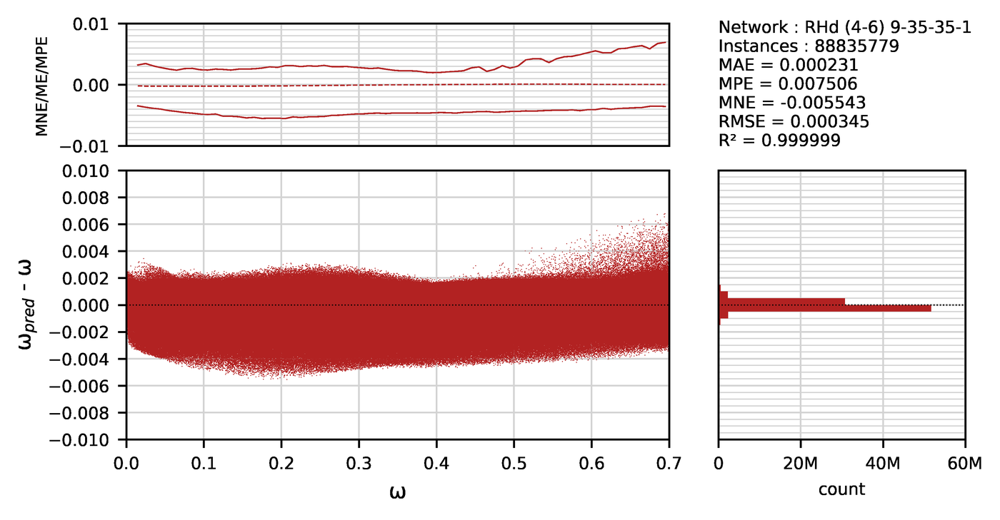
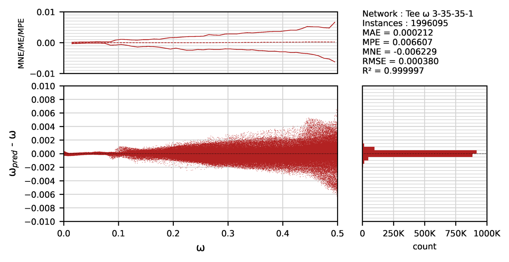 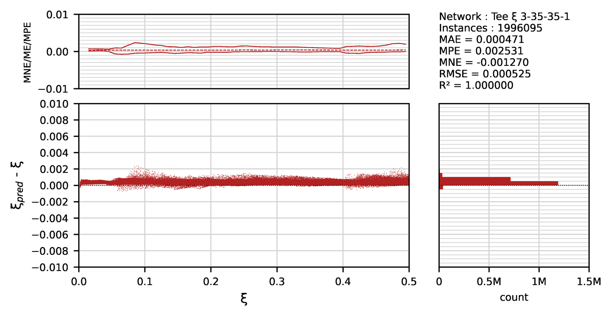

</details>

**Consistency of the nine implementations.** All nine source files of each version were compiled and run on the same inputs (192,000 for v2.0 and 72,000 for v1.0, random, exactly on the range limits and with negative moments): C++ (g++), Java, C#, VB.NET (.NET 8), Fortran (gfortran), Delphi (Free Pascal), Matlab (Octave), Python, and the VBA of the workbooks. All of them return the same values within 4·10⁻¹¹ (Delphi; 2·10⁻¹³ for the rest) and the same `NaN` cases.

**Validation.** The results were also checked against independent section analyses with AnySection and the authors' own biaxial design code, and, for the T-beam, against a separate design library. For circular and square sections, dense grids of millions of input points overlaid on classic design charts reproduce the charts.

**Independent check (October 2026).** 240 random inputs of the networks (40 each for CS, CH and T, 30 each for RSe, RSd, RHe and RHd) were compared with a separate section design written from scratch for this check: EN 1992-1-1:2004 parabola-rectangle concrete, bilinear B500 steel without strain limit, strain pivots 3.5 ‰ and 2 ‰ at 3h/7, fibre integration and a search for the neutral axis depth and angle that matches the direction of the biaxial moment. The differences in ω were at most 0.0005 for the T-beam, 0.005 for CS and CH, 0.007 for RSe and RSd. The hollow sections first showed up to 0.026, which came from the coarse mesh of the thin walls: with a three times finer mesh the largest cases dropped to 0.001 to 0.008, in line with the test results above. The worked example gives ω = 0.4651 against 0.4664 of `w_RSe`.

**Known limitation.** `w_RHd`: in about 0.1 % of the valid inputs (0.3 % for b/h 4 to 6), mainly under high compression (ν below about −0.4) where the concrete section alone carries the actions, the network returns a spurious ω, up to 0.70, instead of 0, most likely because the training data are designs that need reinforcement (ω > 0). The result is on the safe side but uneconomical. It shows as a ω that decreases when the moments increase; a check of the plain concrete section settles it. The other networks did not show this behaviour in the same checks.

---

## Versions

| | v2.0 (`Functions v2.0`, files `MLDF.*`) | v1.0 (`Functions v1.0`, files `functions.*`) |
|---|---|---|
| Paper | Structural Engineering and Mechanics 2024 | Engineering Structures 2021 |
| Released | April 2024 | August 2020 |
| Functions | 18: `w_*` and `As_*` for CS, CH, RSe, RHe, RSd, RHd, plus `w_T`, `x_T`, `As_T`, `w_R`, `x_R`, `As_R` | 6: `w_CS`, `w_CH`, `w_RSe`, `w_RHe`, `w_RSd`, `w_RHd` |
| RSd / RHd | b/h 1 to 6, arguments c/h and t/h | b/h 1 to 2, arguments c/b and t/b |
| Moment boundary | surface network on the moment direction | ellipse fitted to the uniaxial capacities |
| Excel invalid input | `#N/A` | `-1` |

**Use v2.0.** It contains the same CS, CH, RSe and RHe networks as v1.0, with the improved boundary check, and adds the elongated rectangular sections and the beams. v1.0 is kept for reproducibility of the 2021 paper.

### Change log

- **October 2026, general check.** All functions of both versions rerun in all nine languages on 192,000 (v2.0) and 72,000 (v1.0) inputs with identical results, and compared with an independent EC2 section design (see [Accuracy](#accuracy)). Limitation recorded: spurious ω of `w_RHd` where no reinforcement is needed. Fixed: `x_T` and `x_R` returned ξ even where `w_T` is `NaN` (ω above 0.50), with meaningless values above 1; they now return `NaN` (Excel `#N/A`) in the same cases as `w_T`.
- **October 2026, moment signs.** All column functions of both versions now use the absolute values of the moments (the sections are doubly symmetric; negative moments used to return `NaN` or 0). The T-beam and rectangular beam functions return `NaN` for a negative (hogging) moment, or when M − N·y<sub>s1</sub> < 0, instead of 0 or a negative area. Results for positive moments are unchanged; all nine languages verified identical on 160,000 cases (v2.0) and 60,000 cases (v1.0), half of them with negative moments.
- **October 2026.** Review of all files of both versions in all nine languages. Fixed: calls to a non-existent class in the Matlab `As_*`, `w_R` and `x_R` (v2.0); a Greek letter in a function name and a `Math.Max` call in the VBA of `w_RHd` for b/h > 2 (v2.0); the argument order of `Application.Atan2` in the VBA boundary checks (v2.0); the exponent of the hollow sections' ellipse boundary in Fortran (v1.0); single-precision constants in Fortran and range checks in Delphi (both versions). README rewritten.
- **March 2026.** Workbook update.
- **April 2024.** v2.0.
- **August 2020.** v1.0.

---

## Repository structure

```
Project-Omega/
├── Functions v2.0/            current functions (MLDF.*)
│   ├── C#/MLDF.cs
│   ├── C++/MLDF.cpp
│   ├── Delphi/MLDF.pas
│   ├── Fortran/MLDF.f90
│   ├── Java/MLDF.java
│   ├── Matlab/MLDF.m
│   ├── Python/MLDF.py
│   ├── VB.NET/MLDF.vb
│   └── VBA (Excel)/MLDF.xlsm
├── Functions v1.0/            legacy functions of the 2021 paper (functions.*)
├── docs/
│   ├── img/                   section sketches
│   └── accuracy/              error plots of the v2.0 networks
├── LICENSE                    GNU GPL v3
└── README.md
```

---

## How to cite

If you use these functions in research or software, please cite:

> Charalampakis, A.E. and Papanikolaou, V.K. (2024), "Machine learning design of R/C sections revisited", *Structural Engineering and Mechanics*, 92(4), 341–348. https://doi.org/10.12989/sem.2024.92.4.341

> Charalampakis, A.E. and Papanikolaou, V.K. (2021), "Machine learning design of R/C columns", *Engineering Structures*, 226, 111412. https://doi.org/10.1016/j.engstruct.2020.111412

```bibtex
@article{Charalampakis2024,
  author  = {Charalampakis, Aristotelis E. and Papanikolaou, Vassilis K.},
  title   = {Machine learning design of {R/C} sections revisited},
  journal = {Structural Engineering and Mechanics},
  volume  = {92},
  number  = {4},
  pages   = {341--348},
  year    = {2024},
  doi     = {10.12989/sem.2024.92.4.341}
}

@article{Charalampakis2021,
  author  = {Charalampakis, Aristotelis E. and Papanikolaou, Vassilis K.},
  title   = {Machine learning design of {R/C} columns},
  journal = {Engineering Structures},
  volume  = {226},
  pages   = {111412},
  year    = {2021},
  doi     = {10.1016/j.engstruct.2020.111412}
}
```

---

## Authors

- **Aristotelis E. Charalampakis**, Department of Civil Engineering, University of West Attica, Greece
- **Vassilis K. Papanikolaou**, Laboratory of Reinforced Concrete and Masonry Structures, School of Civil Engineering, Aristotle University of Thessaloniki, Greece ([rclab.civil.auth.gr](https://rclab.civil.auth.gr))

The authors thank Prof. P. Tsopelas for providing additional computing resources.

---

## License and disclaimer

Released under the [GNU General Public License v3.0](LICENSE).

The functions are design aids. They reproduce the Eurocode 2 section design described above within the stated ranges and accuracy, for B500 steel. They do not check detailing rules, minimum and maximum reinforcement, second-order effects, shear, serviceability or any other code requirement. The responsibility for the design remains with the engineer.
